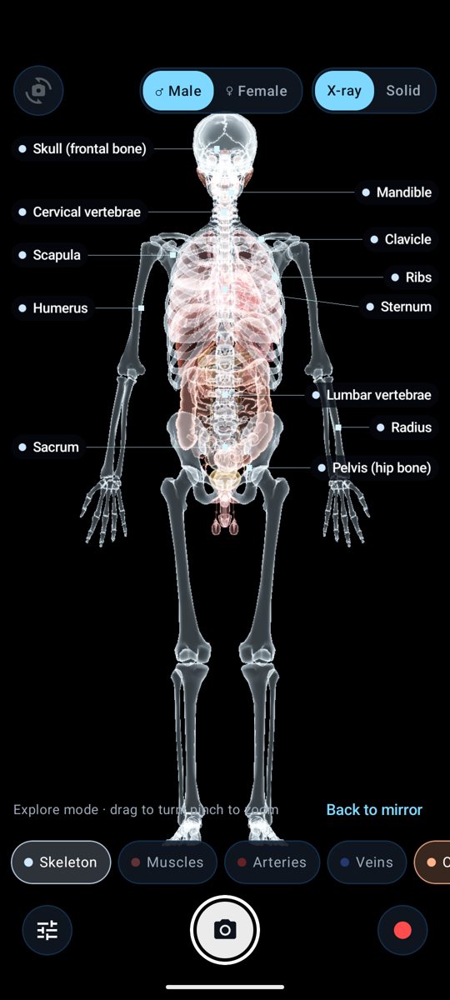
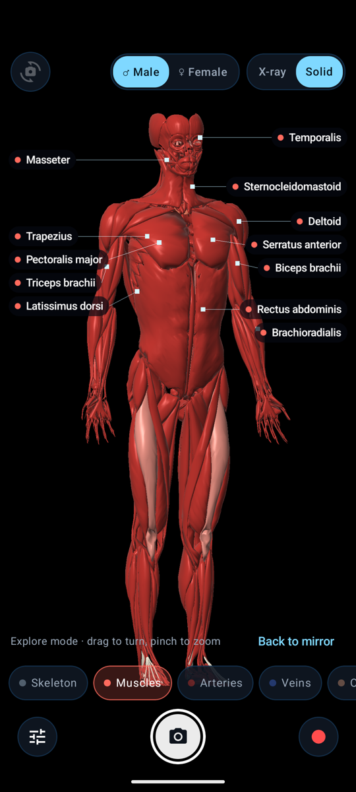
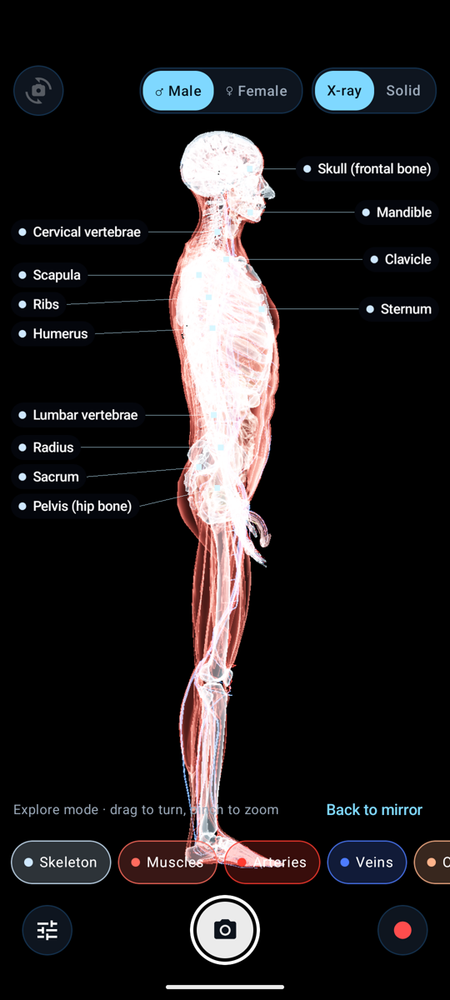
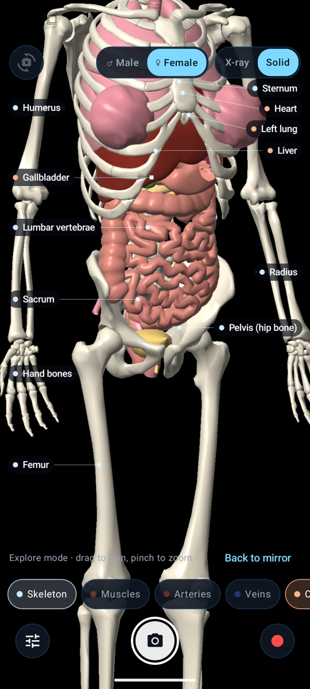
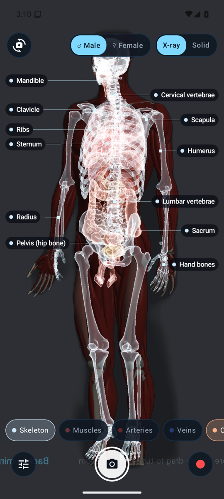

# X-ray Mirror

An Android AR anatomy mirror. Point the camera at a person (or at yourself) and their skeleton, muscles, blood vessels, organs and brain appear on their body, follow their movements, and turn with them when they face sideways or away.

<p align="center">
  
  
  
  
</p>
<p align="center">
  
</p>

## Features

- **Live body tracking.** MediaPipe Pose (33 landmarks, on-device, GPU-accelerated) drives a 16-bone rig. The 3D anatomy bends, stretches and turns with the person, so a side view shows side anatomy and a back view shows the back.
- **Six layers, each toggled on its own:** skeleton, muscles, arteries, veins, organs, brain. Presets: Skeleton, Muscles, Circulation, Organs, Everything.
- **About 1,700 anatomical structures** from the Z-Anatomy atlas (CC BY-SA 4.0): every bone and tooth, around 460 muscles, around 650 named arteries and veins, heart chambers and valves, lungs, digestive tract, kidneys, glands, eyes, and brain gyri and nuclei.
- **Male / female selection** (manual). Female mode swaps in a uterus, cervix, ovaries, uterine tubes, vagina, female urethra and mammary glands, and hides the male reproductive organs.
- **Labels and facts.** Atlas-style callouts with leader lines for the major structures in view. Tap any structure to see its name and a short fact (163 curated entries covering about 980 parts).
- **Two looks:** a glowing **X-ray** look (additive glow, tone-mapped) and a lit **Solid** textbook look.
- **Mixed-reality controls:** how much of the real person shows through, edge feather, keeping the anatomy inside the body outline (person segmentation), and a reveal lens that follows your hand or your finger.
- **Fit to my body:** size, width, height, depth and offset sliders, for fine alignment.
- **Front and rear camera.** Mirror yourself, or scan a friend.
- **Photo and video capture** of exactly what's on screen (video includes mic audio), saved to `Pictures/X-ray Mirror` and `Movies/X-ray Mirror`.
- **Explore mode.** Without a camera or a person, drag to turn the model and pinch to zoom.
- **Fully offline.** No network permission; nothing leaves the phone.

## Requirements

- Android 8.0 (API 26) or later, with OpenGL ES 3.0 and a camera. Built and tuned for the Pixel 8. MediaPipe uses the GPU when the phone has OpenGL ES 3.1+ and falls back to the CPU otherwise.
- To build: JDK 17, Android SDK (platform 36, build-tools 36), and Gradle 8.14 (the wrapper is included). macOS or Linux.
- To rebuild the 3D assets (optional; the built assets are checked in): Blender 4+ and Python 3 with NumPy and Pillow.

## Install

### Prebuilt APK

APKs aren't committed. Build one with `./build.sh release` (it lands in `release/`), or take it from the repository's Releases page if one is published.

1. Copy `release/XrayMirror-1.0.0.apk` to the phone (or use `adb install -r release/XrayMirror-1.0.0.apk`).
2. Open it and allow **Install unknown apps** for the app you opened it from.
3. Launch **X-ray Mirror** and allow camera access.

The APK is signed with the Android SDK's standard debug key, which is fine for sideloading. To update, install the new APK over the old one.

### Build from source

```bash
./build.sh release      # minified release APK -> release/XrayMirror-<version>.apk
./build.sh              # debug APK
./build.sh install      # release APK, then adb install to the connected phone
```

## Permissions

| Permission | Why |
|---|---|
| Camera | The mirror itself. Frames are processed in memory and never stored unless you take a photo or video. |
| Microphone | Only requested when you start a video, for its soundtrack. Deny it to record silent video. |
| Storage (Android 8–9 only) | Saving photos and videos to the gallery. Android 10+ needs no storage permission. |

## Usage

| Action | How |
|---|---|
| Toggle a layer | Tap its chip (Skeleton, Muscles, Arteries, Veins, Organs, Brain) |
| Male / female | Top bar toggle |
| X-ray / Solid look | Top bar toggle |
| Switch camera | Top-left button |
| Identify a structure | Tap the body part or its label: the part highlights, gets its own label, and the info card shows its name and a fact. Tap empty space to clear |
| Zoom (mirror) | Pinch with two fingers; zooms around your fingers. Drag to move around while zoomed. Double-tap to reset |
| Photo / video | Shutter (centre) / red record button |
| Presets, labels, brightness, reveal lens, fit sliders | ⚙ (bottom-left) |
| Explore mode | "Explore without a person", or ⚙ → Explore mode. One finger turns the model; two fingers zoom around the pinch point and move it. Double-tap to reset |

Best results come with the whole body in frame, about 2–3 m from the phone, in even light. For a close-up mirror, use the rear camera on a friend, or prop the phone up.

## How it works

1. **Camera → pose.** CameraX delivers 1280×720 RGBA frames into a small ring of reusable bitmaps. Each frame is rotated upright and halved (360×640) on the CPU before it goes to MediaPipe Pose Landmarker (live-stream mode, GPU delegate). MediaPipe's own rotation option turned the image the wrong way on the Pixel 8, so the app rotates frames itself. MediaPipe returns 33 image landmarks, 33 metric world landmarks and a person segmentation mask; on the GPU path the mask arrives as RGBA bytes and is uploaded to the GPU as-is. At most two frames are in flight (about 65 ms latency on a Pixel 8). The renderer draws the *same* frame the pose came from, so the anatomy never lags behind the picture.
2. **Pose → bones.** In close-ups, where hips and legs are out of frame, the hidden lower body is rebuilt hanging below the shoulders and blended toward MediaPipe's values as they become visible. The head is sized by its own ear-to-ear distance, because it is often much nearer the camera than the body. Landmarks are smoothed with One-Euro filters and lifted to 3D: image x/y in pixels, with depth from the world landmarks scaled by a pixels-per-metre estimate. Torso and head get their full orientation from landmark triangles (hips, shoulders, ears and nose). Each limb inherits its parent's rotation plus the shortest swing toward the next joint, and forearm/hand twist comes from the index–pinky line. Every bone is stretched along its axis so it ends exactly on the tracked joint, which fits the model to any body's proportions.
3. **Bones → anatomy.** Each of the 1,711 parts is skinned to up to four of the 16 bones. Bones of the skeleton are rigid; muscles, vessels and organs blend by distance to the bone segments. GPU linear-blend skinning places about 450k triangles in one draw call per layer.
4. **Rendering.** OpenGL ES 3.0 on its own EGL thread. The camera background is dimmed inside the person mask. The anatomy is drawn into a 75%-resolution half-float buffer and composited back. In X-ray mode that buffer holds additive Fresnel glow with exposure tone mapping; in Solid mode it holds lit, depth-tested surfaces. Callouts are cached text textures, and their on-screen rectangles are kept for tap hit-testing. Tapping the body runs an ID pass over a small scissored area around the finger, encoding part IDs in red/green bytes with float maths, because the Pixel's GPU mishandles unsigned-integer shifts in shaders. Video recording reuses the finished frame through a second EGL surface on the encoder (MediaRecorder).
5. **Assets.** `tools/export_zanatomy.py` (Blender, headless) converts the Z-Anatomy atlas to meshes, turning vessel curves into tubes and decimating to a triangle budget per layer. `tools/build_assets.py` filters duplicates and sheets (fascia, bursae, sulci), adds the female organs, derives rest-pose landmarks from the bones, computes skin weights and packs `anatomy.bin` + `anatomy.json`. `tools/facts.py` writes and validates the labels and facts.

## Limitations

- The anatomy is a **single adult atlas fitted to your pose**. It shows where structures typically lie, not your own body. It is not a medical tool.
- The female organs are **simplified procedural models** added for this app; the Z-Anatomy source atlas is male. Skeletal proportions don't change with the sex setting.
- Monocular pose tracking guesses depth. Arms crossing in front of the body, very loose clothing, or two people in frame can make the fit wobble. Facing directly away works, but left/right is sometimes confused.
- Fingers don't articulate individually; each hand follows the wrist, index and pinky landmarks.
- When only part of the body is in frame, MediaPipe extrapolates the rest; anatomy outside the frame is simply off-screen.

## Developer notes

- Scripted screenshots: `adb shell am start -n dev.manik.xraymirror/.MainActivity --ez demo true --es layers skeleton,organs --es look solid --es sex female --ef yaw 1.57 --ef zoom 1.5`
- Pose testing without a person: push an image and pass it as `--es testImage /data/local/tmp/person.png`. It runs through the live MediaPipe pipeline at about 15 fps. `tools/render_test_people.py` renders suitable test figures from the atlas.
- Debug overlays and logs: `adb shell setprop log.tag.XrayDebug DEBUG` tints the person mask green and logs landmarks and timings. `adb shell setprop log.tag.XrayDump DEBUG` saves one MediaPipe input frame and its landmarks to `Android/data/dev.manik.xraymirror/files/`. Set them back to `INFO` to turn them off.
- Release builds are minified with R8. `app/proguard-rules.pro` keeps MediaPipe, protobuf and Flogger intact; without the Flogger rule, MediaPipe fails at startup with "no caller found on the stack".
- Rebuild assets: `Blender -b Startup.blend --python tools/export_zanatomy.py -- .assets-src/export`, then `python3 tools/build_assets.py && python3 tools/facts.py`.

## Project layout

```
xray-mirror/
├── app/src/main/
│   ├── assets/                 anatomy.bin, anatomy.json, facts.json, pose_landmarker_full.task
│   ├── java/dev/manik/xraymirror/
│   │   ├── MainActivity.kt     wiring, permissions, capture
│   │   ├── Settings.kt         layers, look, sex, reveal, fit
│   │   ├── camera/             FramePipeline (CameraX + MediaPipe), MediaSaver (photo/video)
│   │   ├── pose/               BodyFit (landmarks → bone matrices), OneEuro, Math3
│   │   ├── gl/                 XrayRenderer, Shaders, AnatomyModel, LabelRenderer, Facts, EglCore
│   │   └── ui/                 MirrorScreen (Compose controls)
│   └── res/
├── tools/                      export_zanatomy.py, build_assets.py, facts.py, render_test_people.py
├── docs/screenshots/
├── build.sh
└── README.md
```

## License

App code: MIT. See [LICENSE](LICENSE).

Anatomy data: [Z-Anatomy](https://github.com/Z-Anatomy/Models-of-human-anatomy), CC BY-SA 4.0, which is derived from [BodyParts3D](https://dbarchive.biosciencedbc.jp/en/bodyparts3d/) © The Database Center for Life Science (CC BY-SA 2.1 JP). The derived asset files `anatomy.bin` and `anatomy.json` are shared under CC BY-SA 4.0. Pose model: Google MediaPipe Pose Landmarker (Apache 2.0).
